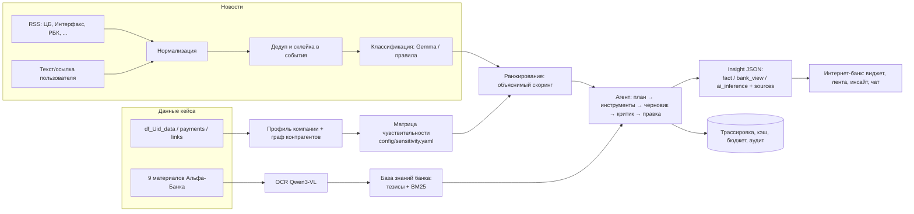

# Бизнес-радар — персонализированная новостная аналитика для клиентов КИБ

Прототип для трека «Новостная аналитика для принятия бизнес-решений» хакатона Альфа-Банка.

Сервис встраивается в интернет-банк для бизнеса. Он показывает компании не новостную ленту, а **интерпретацию событий через её собственный профиль**: отрасль, продукты банка, ВЭД, контрагентов из графа платежей и роль пользователя. Каждый вывод разделён на три типа (**факт / позиция Альфа-Банка / вывод сервиса**) и ведёт на первоисточник. Путь к выводу можно восстановить по трассировке шагов агента.

> Пример. Компания: девелопер с кредитом. Событие: ЦБ сохранил ставку 14%.
> Сервис не пересказывает новость. Он отвечает: «Для компании (строительство, с кредитом) это риск: ожидавшееся удешевление кредитов откладывается, бюджет на обслуживание долга стоит пересчитать по консервативному сценарию». Ниже показана позиция банка: «ожидаем сохранения паузы 23 октября, прогноз ставки на конец 2026 г. повышен до 14,0%» [bank:t01]. Затем идут действия: пересчитать график процентных платежей, оценить долю долга с плавающей ставкой.

## Быстрый старт

[](https://codespaces.new/ManyManyAs/alfa-news-insights)

```bash
docker compose up --build
# открыть http://localhost:8000      (Swagger: http://localhost:8000/docs)
```

Ничего настраивать не нужно:
- **данные кейса уже в репозитории** (`data/case/*.csv.gz`) — первый старт строит профили 85 тыс. компаний и граф платежей примерно за 20–30 секунд;
- **ключ к LLM не нужен**: режим `LLM_MODE=auto` без ключа работает как `replay` — результаты моделей, полученные командой в режиме `live`, подгружаются из `data/snapshot/`, а для новых запросов (своя новость, новый вопрос) сервис переходит на детерминированный режим и честно показывает это в карточке («генерация: rules»);
- с ключом (`cp .env.example .env` и заполнить `LLM_API_KEY`, `LLM_BASE_URL`) всё работает вживую на разрешённых моделях.

Или в браузере: кнопка **Open in Codespaces** выше — окружение поднимется само, сервис откроется на порту 8000.

Тесты: `docker compose --profile test run --rm tests`

Локально без Docker (Python 3.12): `make install && make run` (или `make help` — все команды).

```bash
cd backend
pip install -r requirements.lock           # или: uv sync (uv.lock генерируется в CI)
python -m uvicorn app.main:app --reload    # http://localhost:8000
python -m pytest -q
python scripts/evaluate.py --insights      # метрики качества
```

## Сценарий проверки для жюри

1. Откройте `http://localhost:8000`. На **главной** есть постоянный виджет «Бизнес-радар: что важно для вашего бизнеса сегодня» (критерий 09).
2. Вверху выберите **пользователя**. Демо-учётки подобраны из реальных данных кейса: девелопер с кредитом, импортёр из Китая, IT-компания, ресторан, арендодатель, перевозчик. Лента, причины «почему вам» и знаки риск/возможность перестраиваются (критерии 01, 06).
3. Смените **роль** (финдиректор, казначей, главбух…). Веса факторов меняются, порядок ленты тоже.
4. Откройте событие. Интерпретация отвечает на 6 вопросов кейса. У каждого утверждения есть метка типа и ссылки на источники (критерии 02, 03, 04).
5. Вкладка **«Источники»** ведёт к первоисточникам: новость, документ и страница аналитики банка, признак профиля, связь в графе платежей. Вкладка **«Как получен вывод»** показывает трассировку: план, вызовы инструментов, черновик, самопроверку и правку (критерии 11, 12).
6. В **чате** задайте уточняющий вопрос: «покажи разрез по контрагентам», «что говорит банк?», «откуда выводы?» (критерий 10).
7. Нажмите **«+ Проверить новость»** и вставьте любую свежую новость текстом или ссылкой. Это проверка на событиях, которых сервис раньше не видел (критерий 05). Новость с попыткой prompt injection тоже обрабатывается безопасно: в демо-наборе есть такая, про пошлины на товары из Турции.
8. Раздел **«Качество и бюджет»** показывает режим LLM, расход из лимита 500 ₽ в день, долю инсайтов, прошедших самопроверку, и обратную связь (критерий 08).

## Архитектура



Подробно: [docs/ARCHITECTURE.md](docs/ARCHITECTURE.md). Данные: [docs/DATA.md](docs/DATA.md). Безопасность: [docs/SECURITY.md](docs/SECURITY.md). Качество и мониторинг: [docs/QUALITY.md](docs/QUALITY.md). План работ: [docs/ROADMAP.md](docs/ROADMAP.md).

### Компоненты

| Модуль | Что делает |
|---|---|
| `backend/app/data/profiles.py` | Профиль компании из CSV: продукты, ВЭД, доля в отрасли по выборке, доля в группе, топ-контрагенты из графа платежей, пробелы в данных |
| `backend/app/data/sensitivity.py` + `config/sensitivity.yaml` | Матрица «признак → фактор → вес и знак», линза роли. Новая отрасль или продукт добавляется строкой в конфиге |
| `backend/app/news/*` | Адаптеры источников (RSS, JSONL, ссылка), дедуп и склейка в события, классификация (LLM → правила) |
| `backend/app/knowledge/bank.py` | Тезисы позиции банка (`data/knowledge/bank_theses.json`) и OCR-чанки, поиск BM25, флаг устаревших материалов |
| `backend/app/ranking/scorer.py` | Объяснимый скоринг релевантности и эффекта (риск / возможность) |
| `backend/app/agent/*` | Оркестратор агента, инструменты (allowlist), правила-критик, LLM-промпты, трассировка, чат |
| `backend/app/llm/client.py` | Клиент к разрешённым LLM: роутинг задач по моделям, дневной бюджет, кэш, fallback |
| `backend/app/security/guard.py` | RBAC, защита от prompt injection, аудит |
| `frontend/` | Макет интернет-банка (vanilla JS, без сборки) |

### Модели (только из Приложения 3)

| Задача | Модель | Запасная |
|---|---|---|
| Классификация новостей, реранк | Gemma 4 26B A4B | — |
| План агента, чат | Qwen3.6 35B A3B | Gemma |
| Интерпретация, правка | GLM-5.3-Flash | Qwen3.6 |
| Критик (другая модель, чем автор) | DeepSeek-V4.1-Flash | Gemma |
| Суммаризация и извлечение тезисов из документов | Kimi-K2.6 | Qwen3.6 |
| OCR сканов аналитики | Qwen3-VL-30B-A3B-Instruct | — |

Роутинг и цены лежат в `config/models.yaml`. При 80% дневного лимита включаются запасные модели. При 100% сервис переходит в детерминированный режим (правила и шаблоны): продолжает работать и не тратит деньги. Ответы LLM кэшируются и сохраняются в снапшот — так жюри видит результат моделей и после отключения ключа. Как HTTP-клиент используется собственный клиент на `httpx` к OpenAI-совместимому эндпоинту организаторов.

Готовые мультиагентные фреймворки не используются: оркестратор, инструменты, критик и поиск написаны командой (`backend/app/agent/`).

## Переменные окружения

| Переменная | По умолчанию | Описание |
|---|---|---|
| `LLM_MODE` | `auto` | `auto` — `live` при наличии ключа, иначе `replay`; `live` — вызывать разрешённые LLM; `replay` — только ответы из снапшота (без ключа); `mock` — без LLM |
| `LLM_BASE_URL` | — | OpenAI-совместимый эндпоинт организаторов (`…/v1`) |
| `LLM_API_KEY` | — | Общий ключ команды |
| `LLM_TIMEOUT_S` | `60` | Таймаут запроса к LLM |
| `DB_PATH` | `data/processed/app.db` | SQLite (схема переносится в PostgreSQL) |
| `DATA_SOURCE_DIR` | авто | Каталог CSV: `data/raw` (свои) → `data/case` (кейс, в репозитории) → `data/sample` (синтетика) |
| `USE_SNAPSHOT` | `true` | Подгружать снапшот результатов LLM из `data/snapshot` при первом старте |
| `MAX_COMPANIES` | `0` | Ограничить число компаний (0 — все) |
| `ENABLE_SCHEDULER` | `false` | Фоновый сбор RSS каждые `schedule_minutes` из `config/sources.yaml` |
| `ALLOW_URL_FETCH` | `true` | Разрешить анализ новости по ссылке |

Id моделей у провайдера уточните у организаторов и пропишите в `config/models.yaml`.

## API (кратко; полная схема — `/docs`)

Все запросы к данным компании идут с заголовком `X-User-Id`. Пользователь видит только связанные с ним компании.

| Метод | Путь | Назначение |
|---|---|---|
| GET | `/api/demo-users` | Тестовые учётки и роли |
| GET | `/api/me` | Компании пользователя |
| GET | `/api/companies/{id}?role=` | Профиль и чувствительность к факторам |
| GET | `/api/feed?company_id=&role=` | Персональная лента с причинами |
| GET | `/api/insights/{event_id}?company_id=&role=&refresh=` | Интерпретация (запускает агента или берёт кэш) |
| GET | `/api/insights/{event_id}/stream?...` | То же с прогрессом шагов агента в реальном времени (SSE) |
| POST | `/api/chat/stream` | Ответ ассистента потоком (SSE) |
| GET | `/api/llm/status` | Режим LLM, бюджет дня, роутинг моделей, снапшот |
| GET | `/api/trace/{trace_id}` | Шаги агента |
| POST | `/api/news/analyze` | Новость текстом или ссылкой → событие → инсайт |
| POST | `/api/chat` | Уточняющий вопрос по инсайту |
| POST | `/api/feedback` | 👍/👎 с причиной |
| GET | `/api/metrics` | Бюджет LLM, качество, обратная связь |
| POST | `/api/ingest/run` | Сбор новостей из источников |

## Живые прогоны на моделях (GitHub Actions)

Ключ команды хранится только в секретах репозитория и не попадает в код:

1. Settings → Secrets and variables → Actions → **New repository secret**: `LLM_API_KEY` и `LLM_BASE_URL` (эндпоинт организаторов, `…/v1`).
2. При необходимости — **Variables** `LLM_MODEL_GEMMA`, `LLM_MODEL_GLM`, `LLM_MODEL_QWEN`, `LLM_MODEL_DEEPSEEK`, `LLM_MODEL_QWEN_VL`, `LLM_MODEL_KIMI` (точные id моделей у провайдера; `check` подскажет их сам).
3. Actions → **LLM live run** → Run workflow:
   - `check` — доступность моделей, JSON-режим, vision, латентность → `docs/llm/llm_check.md`;
   - `benchmark` — сравнение моделей на задачах сервиса → `docs/llm/BENCHMARK.md`;
   - `warmup` — разборы событий и инсайты демо-персон → снапшот `data/snapshot/` для проверки без ключа.

Результаты приходят PR-ом из ветки `live-results`; лимит расходов на прогон задаётся параметром `max_rub`.

## Служебные скрипты

```bash
uv run python scripts/manage.py snapshot-export      # сохранить результаты LLM для проверки без ключа
uv run python scripts/manage.py bootstrap --force    # пересобрать профили и демо-новости
uv run python scripts/manage.py ingest               # собрать RSS
uv run python scripts/manage.py warmup --max-rub 100 --background   # предрасчёт разборов и инсайтов демо-персон
uv run python scripts/llm_check.py                   # проверка моделей организаторов
uv run python scripts/benchmark_models.py --max-rub 60   # сравнение моделей → docs/llm/BENCHMARK.md
uv run python scripts/extract_bank_theses.py --theses   # OCR PDF банка (Qwen3-VL) + извлечение тезисов (Kimi)
uv run python scripts/evaluate.py --insights         # P@3, nDCG@5, доля инсайтов, прошедших самопроверку
uv run python scripts/make_sample_data.py            # синтетические данные в схеме кейса
```

## Соответствие критериям

| № | Критерий | Где в решении |
|---|---|---|
| 01 | Бизнес-контекст и отбор | Профиль + граф контрагентов + матрица чувствительности + роль → `ranking/scorer.py` |
| 02 | Интерпретация, не пересказ | Цепочка «событие → фактор → признак → эффект», последствия, драйверы, действия; критик проверяет персонализацию |
| 03 | Позиция Альфа-Банка | Тезисы с цитатами и страницами; отдельный тип `bank_view`; честная пометка, если позиции банка нет; флаг устаревших материалов |
| 04 | Отбор, склейка, связь с источниками | Дедуп и события из нескольких источников; у каждого Claim есть `sources`; проверка чисел против текста |
| 05 | Невиданные новости | `/api/news/analyze` (текст/ссылка), классификация по словарю факторов, без привязки к сценариям |
| 06 | Полный сценарий | Вход → виджет → лента → инсайт → действие/продукт → чат |
| 07 | Масштабирование | Факторы, отрасли, продукты, роли, источники и модели задаются YAML-конфигами; адаптеры источников |
| 08 | Метрики и мониторинг | `scripts/evaluate.py`, `/api/metrics`, обратная связь, [docs/QUALITY.md](docs/QUALITY.md) |
| 09 | Точка входа на главной | Виджет «Бизнес-радар» + бейдж рисков в меню |
| 10 | Взаимодействие с аналитикой | Чат, разрез по контрагентам и группе, переход к первоисточнику |
| 11 | Агентная логика | План (LLM/правило), инструменты с allowlist, общий контекст, критик, повторный поиск, правка |
| 12 | Трассируемость | `trace_steps`: вход/выход, модель, токены, стоимость; вкладка «Как получен вывод» |

## Ограничения прототипа

- Сканы аналитики банка не содержат текстового слоя. В репозитории лежат 28 тезисов, извлечённых вручную, с цитатами и страницами. Полный OCR делается скриптом `extract_bank_theses.py` после получения ключа.
- Физлица из `df_Fid_Uid_link_hack.csv` используются как пользователи интернет-банка (для RBAC и демо). В кейсе это «связанные физлица», реальная ролевая модель интегрируется с IAM банка.
- «Доля рынка» — это доля выручки компании среди клиентов выборки с тем же ОКВЭД, а не по всей отрасли. В интерфейсе это подписано.
- Демо-новости (`data/sample/news_seed.jsonl`) написаны по фактам из материалов кейса и помечены как демо. Живые новости подключаются через RSS (`ENABLE_SCHEDULER=true`).

Сторонние компоненты, модели и данные перечислены в [THIRD_PARTY_NOTICES.md](THIRD_PARTY_NOTICES.md).
