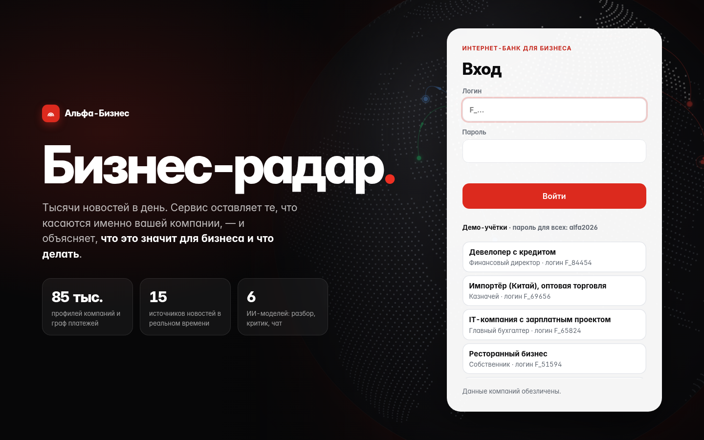
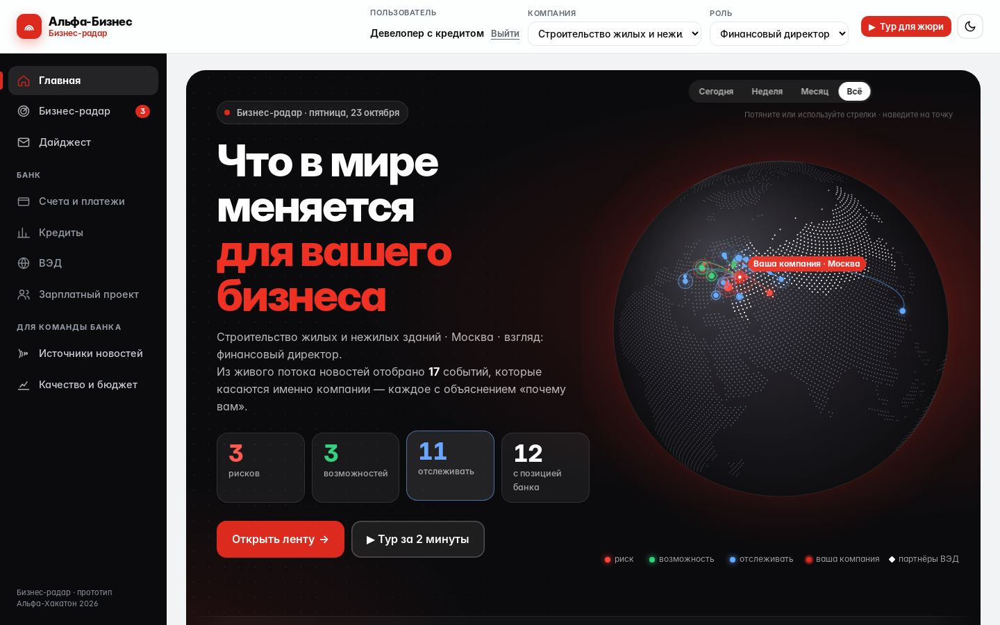
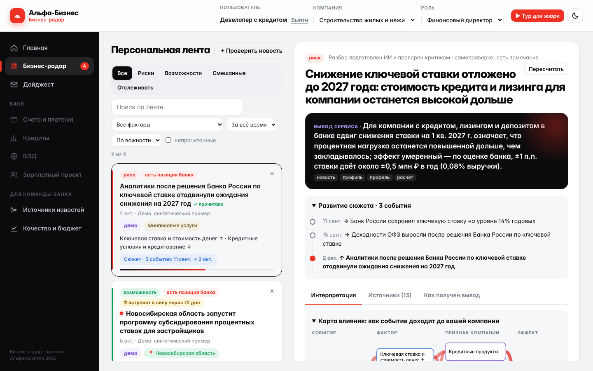
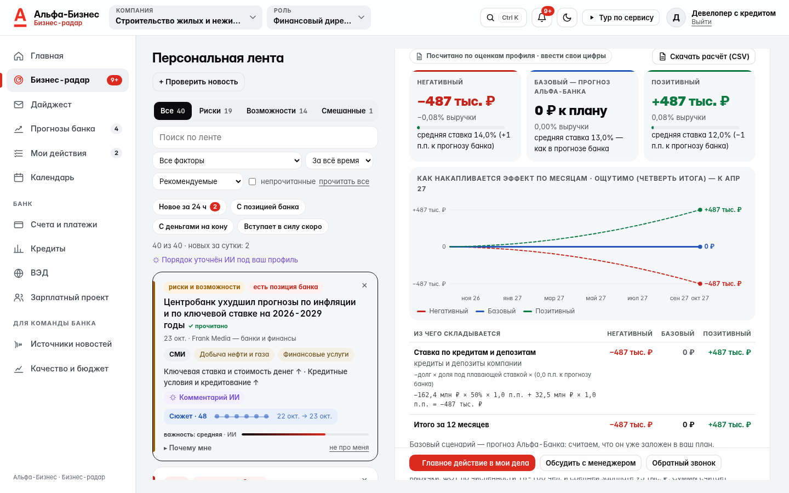
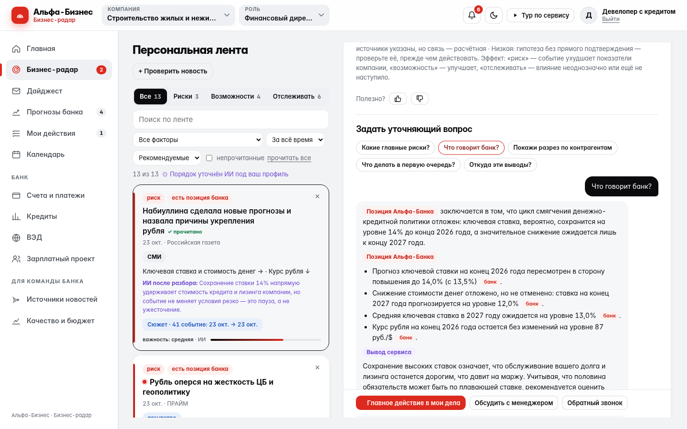
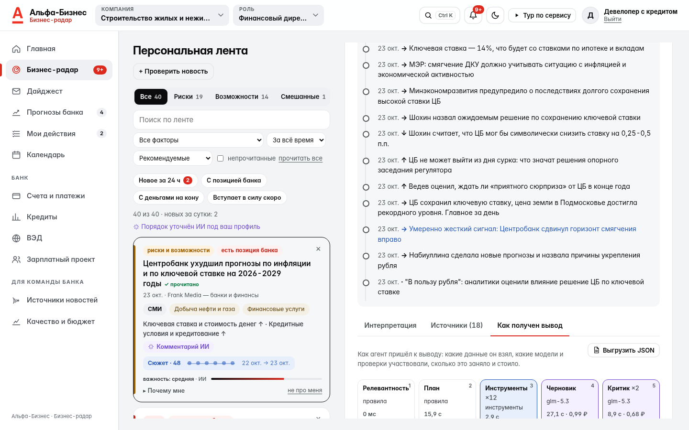
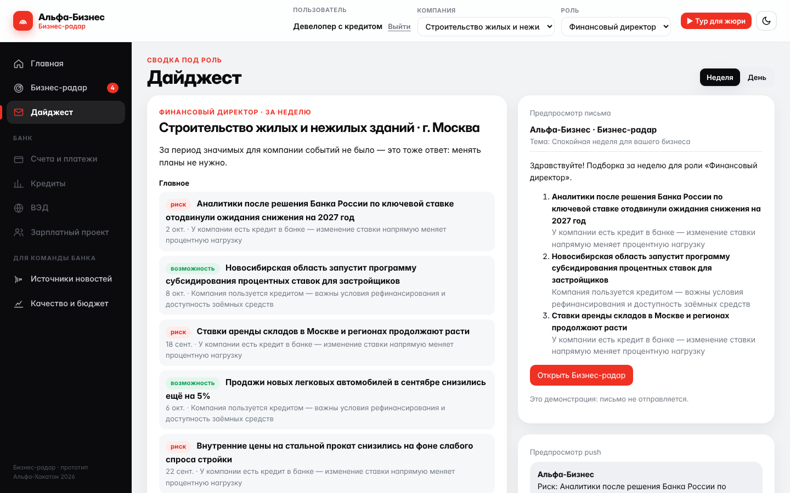
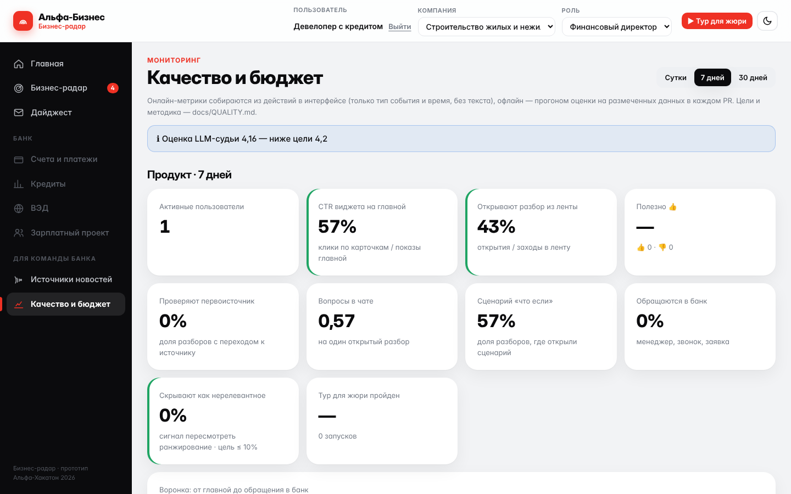
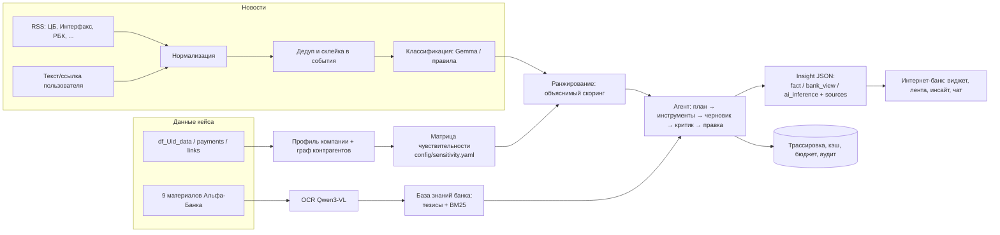

# Бизнес-радар — персонализированная новостная аналитика для клиентов КИБ

Прототип для трека «Новостная аналитика для принятия бизнес-решений» хакатона Альфа-Банка.

Сервис встраивается в интернет-банк для бизнеса. Он показывает компании не новостную ленту, а **интерпретацию событий через её собственный профиль**: отрасль, продукты банка, ВЭД, контрагентов из графа платежей и роль пользователя. Каждый вывод разделён на три типа (**факт / позиция Альфа-Банка / вывод сервиса**) и ведёт на первоисточник. Путь к выводу можно восстановить по трассировке шагов агента.

> Пример. Компания: девелопер с кредитом. Событие: ЦБ сохранил ставку 14%.
> Сервис не пересказывает новость. Он отвечает: «Для компании (строительство, с кредитом) это риск: ожидавшееся удешевление кредитов откладывается, бюджет на обслуживание долга стоит пересчитать по консервативному сценарию». Ниже показана позиция банка: «ожидаем сохранения паузы 23 октября, прогноз ставки на конец 2026 г. повышен до 14,0%» [bank:t01]. Затем идут действия: пересчитать график процентных платежей, оценить долю долга с плавающей ставкой.

[](https://github.com/ManyManyAs/alfa-news-insights/actions/workflows/uptime.yml) [](https://github.com/ManyManyAs/alfa-news-insights/actions/workflows/ci.yml)

**Демо-стенд:** https://77-221-139-69.sslip.io (HTTPS; старый адрес http://77.221.139.69 перенаправляет туда). Это живые модели и живой сбор новостей. Войти можно любой демо-учёткой на экране входа, пароль `alfa2026`. Если стенд недоступен, всё работает локально через `docker compose up` (см. ниже).


## Проверка за 3 минуты

1. `docker compose up --build` → http://localhost:8000. Ключ не нужен: результаты моделей подгружаются из снапшота.
2. Нажмите любую демо-учётку, затем **«▶ Тур для жюри»**. Тур из 9 шагов сам проведёт по экранам.
3. Откройте разбор в ленте и посмотрите:
   - **карту влияния** «событие → фактор → признак компании → эффект»;
   - метки **факт / позиция Альфа-Банка / вывод сервиса**;
   - сценарии в рублях;
   - вкладку «Как получен вывод» (трассировка агента).
4. Нажмите **«+ Проверить новость»** и вставьте любую свежую новость — это проверка на событиях, которых сервис раньше не видел.
5. Смените роль или пользователя. Лента и выводы перестроятся.

| | |
|---|---|
|  |  |
| Вход в интернет-банк | Главная: глобус — события ленты, дуги к вашей компании, подсказка «почему вам» |
|  |  |
| Лента «почему вам» и разбор: главный вывод, сюжет, карта влияния | Сценарии на 12 месяцев и калькулятор «что если» |
|  |  |
| Чат: позиция банка со ссылками на тезисы | Трассировка: план → инструменты → черновик → критик → правка |
|  |  |
| Дайджест под роль, предпросмотр письма и push | Мониторинг: алерты, воронка, скорость, стоимость, LLM-судья |

### Качество в цифрах

Офлайн-оценка пересчитывается в CI на каждый PR; регрессия больше 0,05 блокирует слияние. Подробно — [docs/QUALITY.md](docs/QUALITY.md).

| Что проверяем | Метрика | Значение | Цель |
|---|---|---|---|
| В топ-3 ленты только релевантное (336 пар «профиль — новость») | P@3 | **0,958** | ≥ 0,90 |
| Позиция банка находится, а не выдумывается | recall@5 | **0,975** | ≥ 0,85 |
| Классификация новостей по факторам | F1 / направление | **0,839 / 0,812** | ≥ 0,80 |
| Регионы, отрасли, даты вступления в силу | F1 | **1,0 / 0,973 / 1,0** | ≥ 0,90 |
| Склейка дублей (50 пар, из них 25 трудных негативов) | precision / recall | **0,92 / 0,92** | ≥ 0,90 / 0,85 |
| Разборы проходят самопроверку (числа, даты, источники, дисклеймер) | доля | **100%** | 100% |
| Качество разбора по оценке LLM-судьи (5 осей) | средняя 1–5 | **4,31** | ≥ 4,2 |
| Защита: инъекции, атаки через чат, чужие данные, SSRF | red-team тесты | **43 / 43** | все |

## Быстрый старт

[](https://codespaces.new/ManyManyAs/alfa-news-insights)

```bash
docker compose up --build
# открыть http://localhost:8000      (Swagger: http://localhost:8000/docs)
```

Ничего настраивать не нужно:
- **данные кейса уже в репозитории** (`data/case/*.csv.gz`) — первый старт строит профили 85 тыс. компаний и граф платежей примерно за 20–30 секунд;
- **ключ к LLM не нужен**: режим `LLM_MODE=auto` без ключа работает как `replay` — результаты моделей, полученные командой в режиме `live`, подгружаются из `data/snapshot/`, а для новых запросов (своя новость, новый вопрос) сервис переходит на детерминированный режим и честно показывает это в карточке («генерация: rules»);
- с ключом (`cp .env.example .env` и заполнить `LLM_API_KEY`, `LLM_BASE_URL`) всё работает вживую на разрешённых моделях.

Или в браузере: кнопка **Open in Codespaces** выше — окружение поднимется само, сервис откроется на порту 8000.

Тесты: `docker compose --profile test run --rm tests`

Локально без Docker (Python 3.12): `make install && make run` (или `make help` — все команды).

```bash
cd backend
pip install -r requirements.lock           # или: uv sync (uv.lock генерируется в CI)
python -m uvicorn app.main:app --reload    # http://localhost:8000
python -m pytest -q
python scripts/evaluate.py --insights      # метрики качества
```

## Сценарий проверки для жюри

**Вход.** Откроется экран входа в интернет-банк. Нажмите на любую демо-учётку в списке — вход выполнится сам. Или введите логин и пароль вручную:

| Логин | Компания | Роль |
|---|---|---|
| см. экран входа или `GET /api/demo-users` | девелопер с кредитом, импортёр из Китая, IT-компания, ресторан, арендодатель, перевозчик | финдиректор, казначей, главбух, собственник… |

Пароль для всех демо-учёток: **`alfa2026`**. Логин — идентификатор физлица из данных кейса (`F_…`); после входа видны только компании, где у него есть доступ и которые являются действующими клиентами банка (`CL_TYPE = CLIENT`).

Быстрее всего — кнопка **«▶ Тур для жюри»** вверху страницы: 9 шагов с подсветкой, сервис сам откроет нужные экраны. При первом входе сервис показывает, какие 5 факторов он считает главными для компании и почему.

1. Откройте `http://localhost:8000`. На **главной** есть постоянный виджет «Бизнес-радар: что важно для вашего бизнеса сегодня» (критерий 09) и радар «что сейчас давит на бизнес»: контур — чувствительность компании к факторам, точки — сигналы ленты (риски и возможности).
2. Чтобы сменить **пользователя**, нажмите «Выйти» и войдите другой демо-учёткой. Учётки подобраны из реальных данных кейса: девелопер с кредитом, импортёр из Китая, IT-компания, ресторан, арендодатель, перевозчик. Лента, причины «почему вам» и знаки риск/возможность перестраиваются (критерии 01, 06). Если у пользователя несколько компаний — переключите компанию вверху.
3. Смените **роль** (финдиректор, казначей, главбух…). Веса факторов меняются, порядок ленты тоже. В профиле нажмите на фактор: тема станет «важнее» или скроется из ленты. После 👎 «Не про мой бизнес» в разборе или «скрыть» на карточке похожие новости опускаются ниже, а карточки объясняют почему («▼ Ниже в ленте: вы скрыли похожие новости»). В профиле есть список **«Что сервис понял о ваших интересах»**, где каждый пункт можно отменить. Там же список **«Слежу за»**: добавьте регион, страну, отрасль или тему, и такие события поднимутся в ленте с пометкой «вы следите». Живые новости показываются выше демо-событий: если по теме есть живая новость за 14 дней, демо уступает ей место. При включённой модели ИИ через пару секунд уточняет порядок ленты и пишет у каждой карточки короткую причину.
4. Откройте событие. Главный вывод появляется сразу, полный разбор догружается. Вверху — **карта влияния**: событие → фактор → признак компании или контрагент → эффект (наведите на узел — подсветится путь). Интерпретация отвечает на 6 вопросов кейса. У каждого утверждения есть метка типа, уровень уверенности и ссылки на источники (критерии 02, 03, 04). В блоке последствий — **эффект для компании за 12 месяцев**: три сценария в рублях и % выручки (база — прогноз Альфа-Банка и данные новости), график накопления эффекта по месяцам (с учётом даты вступления нормы в силу) и таблица «из чего складывается» — ставка, курс, зарплаты, выручка через покупателей, цены закупок через поставщиков, налоги. Ниже — «что может изменить вывод» и калькулятор **«Что если»**: двигайте спрос, цены закупок, ставку, курс и рост зарплат или введите свой долг, ФОТ и маржинальность — эффект пересчитается мгновенно.
   В карточках ленты видно доверие к источнику (официально / агентство / СМИ), регионы и отрасли новости, «вступает в силу через N дней» для регуляторики и **сюжеты**: связанные события (решение ЦБ → реакция ОФЗ → прогнозы аналитиков) свёрнуты в одну карточку, а в интерпретации есть таймлайн «Развитие сюжета».
5. Вкладка **«Источники»** ведёт к первоисточникам: новость, документ и страница аналитики банка, признак профиля, связь в графе платежей. Вкладка **«Как получен вывод»** показывает трассировку: план, вызовы инструментов, черновик, самопроверку и правку (критерии 11, 12).
6. В **чате** задайте уточняющий вопрос: «покажи разрез по контрагентам», «что говорит банк?», «откуда выводы?» (критерий 10).
7. Нажмите **«+ Проверить новость»** и вставьте любую свежую новость текстом или ссылкой. Это проверка на событиях, которых сервис раньше не видел (критерий 05). Новость с попыткой prompt injection тоже обрабатывается безопасно: в демо-наборе есть такая, про пошлины на товары из Турции.
8. Раздел **«Дайджест»** — сводка за неделю или день для выбранной роли: главное, сроки вступления норм в силу, сюжеты, пересмотры прогнозов банка; рядом — предпросмотр письма и **уведомления в браузере**. Кнопка «Включить уведомления» подписывает браузер (Web Push). О новом риске высокой важности уведомление приходит сразу после сбора новостей, дайджест — по понедельникам. Кнопка «Отправить тестовое» проверяет доставку.
9. Раздел **«Источники новостей»** показывает 15 источников живого потока: уровень доверия, статус, время опроса, сколько новостей пришло, склеено и отсеяно как шум.
10. Раздел **«Качество и бюджет»** (критерий 08) показывает:
    - алерты;
    - продуктовую воронку от главной до обращения в банк;
    - CTR виджета, долю 👍 с причинами 👎;
    - время до первого вывода и стоимость разбора;
    - оценки LLM-судьи по 5 осям;
    - офлайн-метрики против целей.

    Офлайн-метрики пересчитываются в CI на каждый PR, регрессия блокирует слияние.

## Архитектура



Подробно: [docs/ARCHITECTURE.md](docs/ARCHITECTURE.md). Данные: [docs/DATA.md](docs/DATA.md). Безопасность: [docs/SECURITY.md](docs/SECURITY.md). Качество и мониторинг: [docs/QUALITY.md](docs/QUALITY.md). План работ: [docs/ROADMAP.md](docs/ROADMAP.md).

### Компоненты

| Модуль | Что делает |
|---|---|
| `backend/app/data/profiles.py` | Профиль компании из CSV: продукты, ВЭД, доля в отрасли по выборке, доля в группе, топ-контрагенты из графа платежей, пробелы в данных |
| `backend/app/data/graph.py`, `peers.py` | Граф платежей и связей: отрасли контрагентов, концентрация, PageRank, аффилированность; похожие компании и бенчмарки |
| `backend/app/data/sensitivity.py` + `config/sensitivity.yaml` | Матрица «признак → фактор → вес и знак», линза роли. Новая отрасль или продукт добавляется строкой в конфиге |
| `backend/app/news/*` | Адаптеры источников (RSS, JSONL, ссылка), дедуп и склейка в события, классификация (LLM → правила) |
| `backend/app/knowledge/bank.py` | Тезисы позиции банка (`data/knowledge/bank_theses.json`) и OCR-чанки, поиск BM25, флаг устаревших материалов |
| `backend/app/ranking/scorer.py` | Объяснимый скоринг релевантности и эффекта (риск / возможность) |
| `backend/app/agent/*` | Оркестратор агента, инструменты (allowlist), правила-критик, LLM-промпты, трассировка, чат |
| `backend/app/llm/client.py` | Клиент к разрешённым LLM: роутинг задач по моделям, дневной бюджет, кэш, fallback |
| `backend/app/security/guard.py` | RBAC, защита от prompt injection, аудит |
| `frontend/` | Макет интернет-банка в стиле Альфа-Бизнеса: `app.js` (экраны), `globe.js` (глобус сигналов на главной и на входе: canvas, без библиотек — дуги «событие → ваша компания», партнёры ВЭД), `viz.js` (карта влияния, радар, таймлайн агента — SVG), `tour.js` (онбординг и тур для жюри). Без сборки и зависимостей: открывается сразу после `docker compose up`; светлая и тёмная темы, клавиатурная навигация |

### Модели (только из Приложения 3)

| Задача | Модель | Запасная |
|---|---|---|
| Классификация новостей, реранк | Gemma 4 26B A4B | — |
| План агента, чат | Qwen3.6 35B A3B | Gemma |
| Интерпретация, правка | DeepSeek-V4.1-Flash (лучший по оценке судьи, см. [бенчмарк](docs/llm/BENCHMARK.md)) | GLM-5.3-Flash |
| Критик (другая модель, чем автор) | GLM-5.3-Flash | Gemma |
| Суммаризация и извлечение тезисов из документов | Kimi-K2.6 | Qwen3.6 |
| OCR сканов аналитики | Qwen3-VL-30B-A3B-Instruct | — |

Роутинг и цены лежат в `config/models.yaml`. При 80% дневного лимита включаются запасные модели. При 100% сервис переходит в детерминированный режим (правила и шаблоны): продолжает работать и не тратит деньги. Ответы LLM кэшируются и сохраняются в снапшот — так жюри видит результат моделей и после отключения ключа. Как HTTP-клиент используется собственный клиент на `httpx` к OpenAI-совместимому эндпоинту организаторов.

Готовые мультиагентные фреймворки не используются: оркестратор, инструменты, критик и поиск написаны командой (`backend/app/agent/`).

## Переменные окружения

| Переменная | По умолчанию | Описание |
|---|---|---|
| `LLM_MODE` | `auto` | `auto` — `live` при наличии ключа, иначе `replay`; `live` — вызывать разрешённые LLM; `replay` — только ответы из снапшота (без ключа); `mock` — без LLM |
| `LLM_BASE_URL` | — | OpenAI-совместимый эндпоинт организаторов (`…/v1`) |
| `LLM_API_KEY` | — | Общий ключ команды |
| `LLM_TIMEOUT_S` | `60` | Таймаут запроса к LLM |
| `DB_PATH` | `data/processed/app.db` | SQLite (схема переносится в PostgreSQL) |
| `DATA_SOURCE_DIR` | авто | Каталог CSV: `data/raw` (свои) → `data/case` (кейс, в репозитории) → `data/sample` (синтетика) |
| `USE_SNAPSHOT` | `true` | Подгружать снапшот результатов LLM из `data/snapshot` при первом старте |
| `MAX_COMPANIES` | `0` | Ограничить число компаний (0 — все) |
| `ENABLE_SCHEDULER` | `false` | Фоновый сбор RSS каждые `schedule_minutes` из `config/sources.yaml` |
| `ALLOW_URL_FETCH` | `true` | Разрешить анализ новости по ссылке |

Id моделей у провайдера уточните у организаторов и пропишите в `config/models.yaml`.

## API (кратко; полная схема — `/docs`)

Все запросы к данным компании требуют входа (сессия в cookie или `Authorization: Bearer`). Пользователь видит только связанные с ним компании-клиенты; каждое обращение пишется в журнал доступа.

| Метод | Путь | Назначение |
|---|---|---|
| GET | `/api/demo-users` | Демо-учётки, роли и пароль демо-входа |
| POST | `/api/auth/login`, `/api/auth/logout` | Вход по логину и паролю (сессия в HttpOnly-cookie) и выход |
| POST | `/api/feed/hide` | Скрыть карточку из ленты (или вернуть) |
| POST | `/api/actions` | Действие после инсайта: связаться с менеджером, обратный звонок, заявка на продукт |
| GET | `/api/me` | Компании пользователя |
| GET | `/api/companies/{id}?role=` | Профиль и чувствительность к факторам |
| GET | `/api/feed?company_id=&role=` | Персональная лента с причинами, доверием к источнику, регионами/отраслями, «вступает в силу через N дней» и сюжетами |
| GET | `/api/feed/rerank?company_id=&role=` | Уточнение порядка верха ленты моделью (оценка 0–3 и причина у каждой карточки) |
| PUT/DELETE | `/api/companies/{id}/preferences` | Ручные интересы: тема «важнее» / «как обычно» / «не показывать»; сброс |
| GET | `/api/digest?company_id=&role=&period=week\|day` | Дайджест под роль: главное, сроки, сюжеты, пересмотры прогнозов банка |
| POST | `/api/scenario` | «Что если»: эффект ставки, курса и зарплат в ₽ (база — прогноз банка); свои суммы долга, импорта, ФОТ |
| GET | `/api/stories/{story_id}` | Сюжет: хронология связанных событий |
| GET | `/api/sources/health` | Источники новостей: доверие, статус, ошибки, сколько новостей и шума |
| GET | `/api/insights/{event_id}?company_id=&role=&refresh=` | Интерпретация (запускает агента или берёт кэш) |
| GET | `/api/insights/{event_id}/stream?...` | То же с прогрессом шагов агента в реальном времени (SSE) |
| POST | `/api/chat/stream` | Ответ ассистента потоком (SSE) |
| GET | `/api/llm/status` | Режим LLM, бюджет дня, роутинг моделей, снапшот |
| GET | `/api/llm/budget` | Остаток дневного бюджета на модели (у провайдера или по локальному учёту) |
| GET | `/api/data/quality` | Отчёт о качестве данных кейса и обработке пробелов |
| GET | `/api/bank/forecasts` | Макропрогноз Альфа-Банка с пересмотрами |
| GET | `/api/trace/{trace_id}` | Шаги агента |
| POST | `/api/news/analyze` | Новость текстом или ссылкой → событие → инсайт |
| POST | `/api/chat` | Уточняющий вопрос по инсайту |
| POST | `/api/feedback` | 👍/👎 с причиной; «не про мой бизнес» ослабляет темы события для компании |
| GET | `/api/metrics?days=7` | Алерты, продуктовые метрики, скорость и стоимость, LLM-судья, офлайн-метрики |
| POST | `/api/track` | События интерфейса для продуктовых метрик (без текста) |
| POST | `/api/ingest/run` | Сбор новостей из источников |

## Развёртывание на сервере

Автоматически (рекомендуется): секреты репозитория `DEPLOY_HOST`, `DEPLOY_USER` (обычно `root`) и `DEPLOY_SSH_KEY`
(или `DEPLOY_PASSWORD`) + `LLM_API_KEY`, `LLM_BASE_URL` → workflow **Deploy** при каждом push в `main` копирует код
на сервер, пишет `.env` (права 600) и запускает `deploy/install.sh`: Docker, Nginx (SSE без буферизации, лимиты
запросов, заголовки безопасности), firewall, swap, HTTPS через Let's Encrypt при заданных переменных
`DEPLOY_DOMAIN` и `DEPLOY_EMAIL`.

Вручную на Ubuntu 22.04/24.04:

```bash
git clone https://github.com/ManyManyAs/alfa-news-insights.git /opt/alfa-news-insights
cd /opt/alfa-news-insights && sudo bash deploy/install.sh     # ключ к LLM спросит скрыто
sudo bash deploy/update.sh                                    # обновление
```

## Живые прогоны на моделях (GitHub Actions)

Ключ команды хранится только в секретах репозитория и не попадает в код:

1. Settings → Secrets and variables → Actions → **New repository secret**: `LLM_API_KEY` и `LLM_BASE_URL` (эндпоинт организаторов, `…/v1`).
2. При необходимости — **Variables** `LLM_MODEL_GEMMA`, `LLM_MODEL_GLM`, `LLM_MODEL_QWEN`, `LLM_MODEL_DEEPSEEK`, `LLM_MODEL_QWEN_VL`, `LLM_MODEL_KIMI` (точные id моделей у провайдера; `check` подскажет их сам).
3. Actions → **LLM live run** → Run workflow:
   - `check` — доступность моделей, JSON-режим, vision, латентность → `docs/llm/llm_check.md`;
   - `benchmark` — сравнение моделей на задачах сервиса → `docs/llm/BENCHMARK.md`;
   - `warmup` — разборы событий и инсайты демо-персон → снапшот `data/snapshot/` для проверки без ключа.

Результаты приходят PR-ом из ветки `live-results`; лимит расходов на прогон задаётся параметром `max_rub`.

## Служебные скрипты

```bash
uv run python scripts/manage.py snapshot-export      # сохранить результаты LLM для проверки без ключа
uv run python scripts/manage.py bootstrap --force    # пересобрать профили и демо-новости
uv run python scripts/manage.py ingest               # собрать RSS
uv run python scripts/manage.py warmup --max-rub 100 --background   # предрасчёт разборов и инсайтов демо-персон
uv run python scripts/llm_check.py                   # проверка моделей организаторов
uv run python scripts/benchmark_models.py --max-rub 60   # сравнение моделей → docs/llm/BENCHMARK.md
uv run python scripts/extract_bank_theses.py --theses   # OCR PDF банка (Qwen3-VL) + извлечение тезисов (Kimi)
uv run python scripts/evaluate.py --insights         # P@3, nDCG@5, доля инсайтов, прошедших самопроверку
uv run python scripts/make_sample_data.py            # синтетические данные в схеме кейса
```

## Соответствие критериям

| № | Критерий | Где в решении |
|---|---|---|
| 01 | Бизнес-контекст и отбор | Профиль + граф контрагентов + матрица чувствительности + роль → `ranking/scorer.py` |
| 02 | Интерпретация, не пересказ | Цепочка «событие → фактор → признак → эффект», последствия, драйверы, действия; критик проверяет персонализацию |
| 03 | Позиция Альфа-Банка | Тезисы с цитатами и страницами; отдельный тип `bank_view`; честная пометка, если позиции банка нет; флаг устаревших материалов |
| 04 | Отбор, склейка, связь с источниками | Фильтр шума; дедуп хэш → MinHash → LLM-арбитр; события из нескольких источников и сюжеты с таймлайном; доверие к источнику; у каждого Claim есть `sources`; проверка чисел против текста |
| 05 | Невиданные новости | `/api/news/analyze` (текст/ссылка), классификация по словарю факторов, без привязки к сценариям |
| 06 | Полный сценарий | Вход → виджет → лента → инсайт → действие/продукт → чат |
| 07 | Масштабирование | Факторы, отрасли, продукты, роли, источники и модели задаются YAML-конфигами; адаптеры источников |
| 08 | Метрики и мониторинг | `scripts/evaluate.py`, `scripts/quality_gate.py` (комментарий в PR), `app/monitoring.py`, `/api/metrics`, [docs/QUALITY.md](docs/QUALITY.md) |
| 09 | Точка входа на главной | Виджет «Бизнес-радар» + бейдж рисков в меню |
| 10 | Взаимодействие с аналитикой | Чат, разрез по контрагентам и группе, переход к первоисточнику |
| 11 | Агентная логика | План (LLM/правило), инструменты с allowlist, общий контекст, критик, повторный поиск, правка |
| 12 | Трассируемость | `trace_steps`: вход/выход, модель, токены, стоимость; вкладка «Как получен вывод» |

## Ограничения прототипа

- Сканы аналитики банка не содержат текстового слоя. Все 64 страницы 9 материалов прочитаны командой: в репозитории 77 тезисов (тип, фактор, направление, горизонт, цитата, страница) и 73 числовых прогноза с историей пересмотров. Полные тексты PDF в репозиторий не кладём (запрет на распространение); OCR новых материалов — `extract_bank_theses.py` (Qwen3-VL).
- Физлица из `df_Fid_Uid_link_hack.csv` используются как пользователи интернет-банка (для RBAC и демо). В кейсе это «связанные физлица», реальная ролевая модель интегрируется с IAM банка.
- «Доля рынка» — это доля выручки компании среди клиентов выборки с тем же ОКВЭД, а не по всей отрасли. В интерфейсе это подписано.
- Демо-новости (`data/sample/news_seed.jsonl`) помечены как демо: первые 12 написаны по фактам из материалов кейса, ещё 7 — синтетические примеры для сюжетов, региональности, дат вступления в силу и фильтра шума («Демо: синтетический пример»). Живые новости собираются из 15 RSS-источников (`ENABLE_SCHEDULER=true`, на сервере включено); их состояние — на экране «Источники новостей».

Сторонние компоненты, модели и данные перечислены в [THIRD_PARTY_NOTICES.md](THIRD_PARTY_NOTICES.md).
